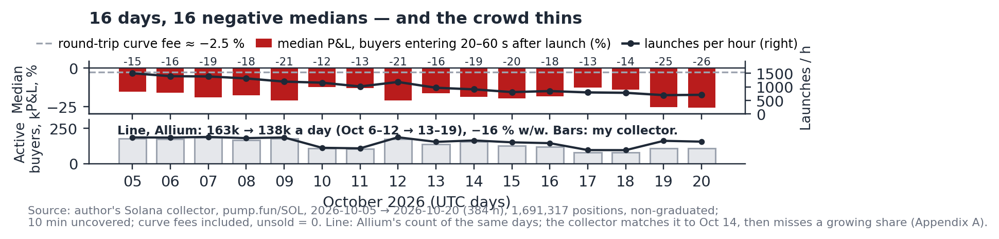
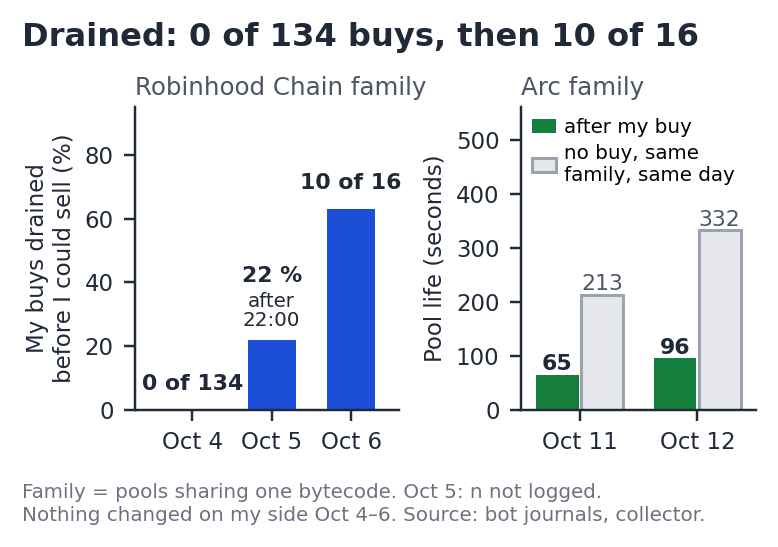

# I Ran Bots Inside Token Factories. Here Is What They Say About PUMP.

> **SHORT PUMP against SOL · price $0.00474 (Oct 21, 2026) · target $0.0022 (−54 %) by April 28, 2027 · thesis stop: weekly revenue ≥ $16M for four weeks, or active buyers back above 155,000 a day on Allium's count, or launchpad fees ≥ $58M a week · catastrophe stop: PUMP/SOL ×2 on a daily close.**
> A game the crowd loses every day, measured position by position for sixteen days (median −17.4 %, negative on 16/16 days; buyers −16 % in a week on Allium's count, −36 % in four weeks from the late-September peak); a price set on one peak week; a buyback that ends in April 2027 while 6.875B tokens a month unlock to insiders. The paper: [`paper/PUMP-short-draft-2026-11-06.pdf`](paper/PUMP-short-draft-2026-11-06.pdf).

<p align="center"></p>

**Start here, three files:** [`NUMBERS.md`](NUMBERS.md) (every number of the paper recomputed, PASS/FAIL), [`docs/pumpfun/00-README.md`](docs/pumpfun/00-README.md) (the research on pump.fun at full depth), [`bots/README.md`](bots/README.md) (what the bots did and what is published).

Data, code and figures behind a short thesis on PUMP (pump.fun) written for the Franklin Crypto Research Competition at UBC 2026 (track: Short, market cap > $1B). Author: Jean-Baptiste Durand, solo. The paper is in [`paper/`](paper/). Every number in the paper has a command here; the table below says which ones can be recomputed from the files in this repository and which ones need the raw collector files.

## Reproduce in two commands

```
python3 -m venv .venv && .venv/bin/pip install -r requirements.txt
.venv/bin/python check/check_numbers.py      # or: make check   → results/numbers.csv, results/numbers.md
```

No API key is needed (Python ≥ 3.9, matplotlib for the figures). `make figures` redraws the paper's five figures and the appendix figures from the same files (`figures/fig1_…` to `fig5_…`: the 16 days, the operators' response to my bots, the food chain, the three peaks, the dated path; `figB1`, `figC1`, `figD1–D3`); `make report` regenerates the full pump.fun research report in `docs/pumpfun/`. Scripts read `data/` relative to the repository root. On macOS use `python3` and `pip3`.

## Results: the paper's claims, recomputed

| Claim in the paper | Recomputed here | Command | File | Status |
|---|---|---|---|---|
| Crowd median P&L −17.4 % on 1,691,317 positions entered 20–60 s after launch; negative on 16/16 days | −17.41 %; 16/16 | `make check` (B12, B3) | `data/pumpfun-16d/crowd_20-60s.csv.gz`, `data/pumpfun-16d/2026-10-*.json` | B |
| Same, valued at the last curve price −15.4 %; excluding never-sold positions −12.2 % | −15.38 % / −12.20 % | `make check` (B13, B14) | `data/pumpfun-16d/crowd_20-60s.csv.gz` | B |
| Active buyers, Oct 6–12 vs Oct 13–19: −16 % on Allium's count (163,333 → 137,677 a day); my collector −26 % (155,300 → 114,481), undercounted after Oct 14 | collector: 155,300 → 114,481 (−26.3 %); Allium: `crosscheck/results/allium/q1-overlap-daily.csv` | `make check` (B17, B18) | `data/pumpfun-16d/active_buyers_by_day_ids.csv.gz` | B |
| Second pipeline (Allium): most tolerances fail; the collector loses coverage after Oct 14; crowd median −13.2 % in Allium | verdict table | — | `crosscheck/results/allium/README.md` | Allium |
| LaunchLab swaps −71 % on the same days in my collector, −54 % on Allium's count (same-chain control) | −71.1 % | `make launchlab` | `data/pumpfun-16d/2026-10-*.json` | B |
| Take rate 100 % (Jan 2025) → 58 % (Jul 2025) → 32 % (Sep 2026), 35 % trailing 30 days | 100 / 58.5 / 32.1 / 35.3 % | `make check` (A1–A4) | `data/raw/llama_pump_{fees,revenue}.json` | A |
| Base revenue Feb–Jun 2026 $398M/yr; multiple 2.62×; target $0.00226 (−54 % from $0.00474) | 398.0 / 2.62× / $0.00226 | `make check` (A8, A17, A18) | `data/raw/llama_pump_revenue.json`, `cg_pump_chart.json`, `cg_pump_coin.json` | A |
| Revenue −87 % after the first peak, −52 % after the second; peak week $17.9M, last 7 days $14.0M | −86.6 % / −52.0 % / 17.86 / 14.05 | `make check` (A11–A14) | `data/raw/llama_pump_revenue.json` | A |
| Launchpad fees (16 venues, launchpads only) $6.5M → $85M → $26M; pump.fun share 83 → 10 → 52 % | 6.5 / 85.3 / 25.8; 82.6 / 10.5 / 51.9 % | `make check` (A22–A25) | `data/raw/llama_lp_*_fees.json` | A |
| Food chain by address (Fig. 3): one-off buyers −46 %, > 2,000 positions −4 % | script published; run by the author on Oct 26 → `results/food_chain_recomputed.json` = the published aggregate | `make foodchain` | needs the per-position files | C |
| Pool life 65 s after my buy vs 213 s without (Arc, Oct 11); my buys drained 0 → 22 → 63 % (Robinhood Chain, Oct 4–6) | typed from the bot journals | — | `data/bots-daily.csv`, `bots/` | C (journals) |
| ≈ $804 recovered, about zero overall; four sweeps to one vault | on-chain | — | `bots/sweeps.md`, `bots/reconciliation.csv` | A (on-chain) |

**A** = recomputed from the public API responses saved in `data/raw/` · **B** = recomputed from my published collector outputs · **C** = needs the 3.9 GB of per-position files (`*.positions.jsonl`, on request) or the 8.6 GB of hourly collector files. The full list (55 checks PASS, 4 marked C) is in [`results/numbers.md`](results/numbers.md).

## What is here
- `docs/` — **the research behind the paper, as documents**: `docs/pumpfun/` (method and instrument; the public series since March 2024; the collector's 16 days table by table; valuation, comparables and derivatives; the arguments, the objections tested and the limits; the lab's Solana notes and the author's working notes, translated) and `docs/arc-robinhood/` (the lab's working documents on the factory pools of Arc and Robinhood Chain, written in French before the paper and translated for publication: method and verdict, the September 9 break, the complete dossier, the Arc families and the rules written before measuring). Index in `docs/README.md`.
- `paper/` — the paper (PDF; the submitted version will be tagged `submission-2026-11-09`).
- `data/raw/` — 46 raw API responses saved on Oct 21–22, 2026 (DefiLlama fees and revenue per launchpad and per product, CoinGecko prices, market caps and supply, Binance funding and open interest, Hyperliquid contexts, the Solscan holder table read by hand). Nothing is edited.
- `data/pumpfun-16d/` — my pump.fun collector, 16 UTC days (Oct 5–20, 2026): one JSON per day (the tool's full output), the 16 run logs (coverage, canary, formula checks, time and memory), the aggregates (`aggregate-pumpfun.*`, `users.*`, `food-chain-published.*`), and two compact files that make the headline numbers reproducible without the raw positions: `crowd_20-60s.csv.gz` (one row per 20–60 s position: day, entry age, SOL paid, strict and valued P&L, never-sold, closed; no address) and `active_buyers_by_day_ids.csv.gz` (addresses replaced by integer ids).
- `data/sample/` — one raw hour of the collector (October 6, 2026, 12:00 UTC), truncated to its first 20,000 lines (2.5 MB), so that the input format of `scripts/lab/solana-courbes.mjs` can be read; the full hourly files (8.6 GB) are on request.
- `crosscheck/` — the definitions and tolerances fixed on October 26; the Allium queries, committed before their first run and public in Allium; the results and the verdicts, failures included (`crosscheck/results/allium/README.md`, Fig. A1).
- `data/arc-17d/` — the 17-day ranking of Arc factory-pool addresses (output of `scripts/lab/gagnants.mjs`).
- `data/*.csv|json` — derived weekly series (launchpads, pump.fun vs Pons vs Argus) and the day-by-day bot table `bots-daily.csv`.
- `bots/` — the money reconciliation, the four sweep transactions, and what is not published and why.
- `check/` — `check_numbers.py` (PASS/FAIL against the paper) and `robustness_2060.py` (strict vs valued medians; its output is in `results/robustness_2060.csv`).
- `scripts/` — the six figure scripts, `launchlab_control.py`, `food_chain.py`, `export_level_b.py`, and `scripts/lab/` (the Solana lab tools, JavaScript, read-only, run once per UTC day on the collector's hourly files).
- `results/` — outputs of the checks.
- `NUMBERS.md` — the canonical list of numbers used in the paper, with how each was computed.

## What is not here
- The per-position files (`*.positions.jsonl`, 3.9 GB) and the collector's hourly files (8.6 GB compressed): on request; `check/robustness_2060.py` and `scripts/food_chain.py` need them (status C).
- The trading code and raw bot journals (keys, wallets, servers): see `bots/README.md`.
- No private keys, no credentials, ever. The 64-hex constants in `scripts/lab/topics.mjs` are public EVM event signatures.

## Licence
Code: MIT (`LICENSE`). My data and figures: CC BY 4.0 (`LICENSE-data`). Third-party API responses in `data/raw/` remain their providers'.
